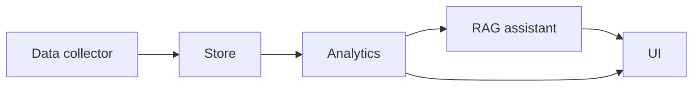
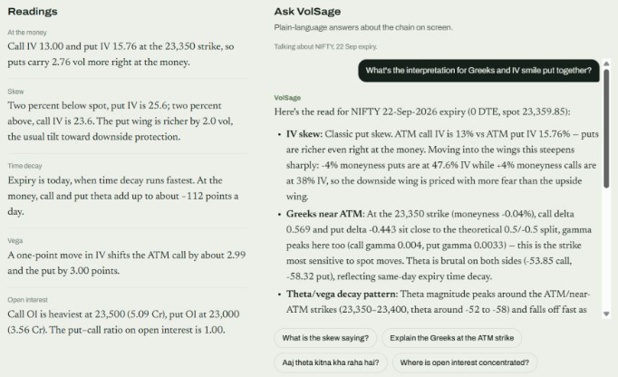
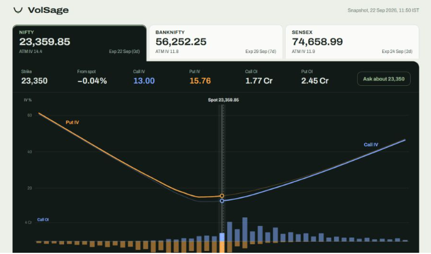
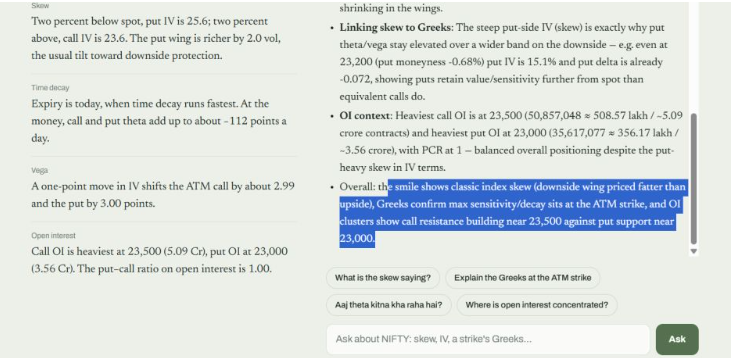

# VolSage

**Ask your options chain questions in plain language.**

**Status:** working prototype. Closed-source. Demo on request.

## The gap

Tools like Sensibull, Opstra and Quantsapp already exist and are good at showing options data: chains, payoffs, Greeks, OI. What they leave to the user is the reading of it. VolSage adds a plain-language interpretation layer on top of the same kind of data: you look at a chain, ask what it means, and get an answer grounded in the numbers on screen.

## What it does

- Covers NIFTY, BANKNIFTY and SENSEX.
- IV smile, today versus yesterday.
- Open interest and OI change by strike.
- Greeks table per strike.
- A RAG assistant that answers in English and Hinglish about the chain currently on screen.

## How it fits together

Component names only; the implementation is not published.

## Screenshots

**Asking about Greeks and the IV smile together**

**Dashboard: IV smile with OI by strike**

**Readings panel next to the assistant**

## Example questions

- What is the skew saying?
- Explain the Greeks at the ATM strike.
- Where is open interest concentrated?
- How does today's smile compare with yesterday's?
- What's the interpretation for Greeks and IV smile put together?
- Aaj theta kitna kha raha hai?

## Roadmap

- An evaluation set that checks the assistant's answers against my own reads of the chain.
- More underlyings.
- Historical snapshots.

## Disclaimer

Observational analytics only. Not investment advice. Not a SEBI-registered research or advisory product.

## Contact

[LinkedIn](https://www.linkedin.com/in/mudit-popli-78558b206)
